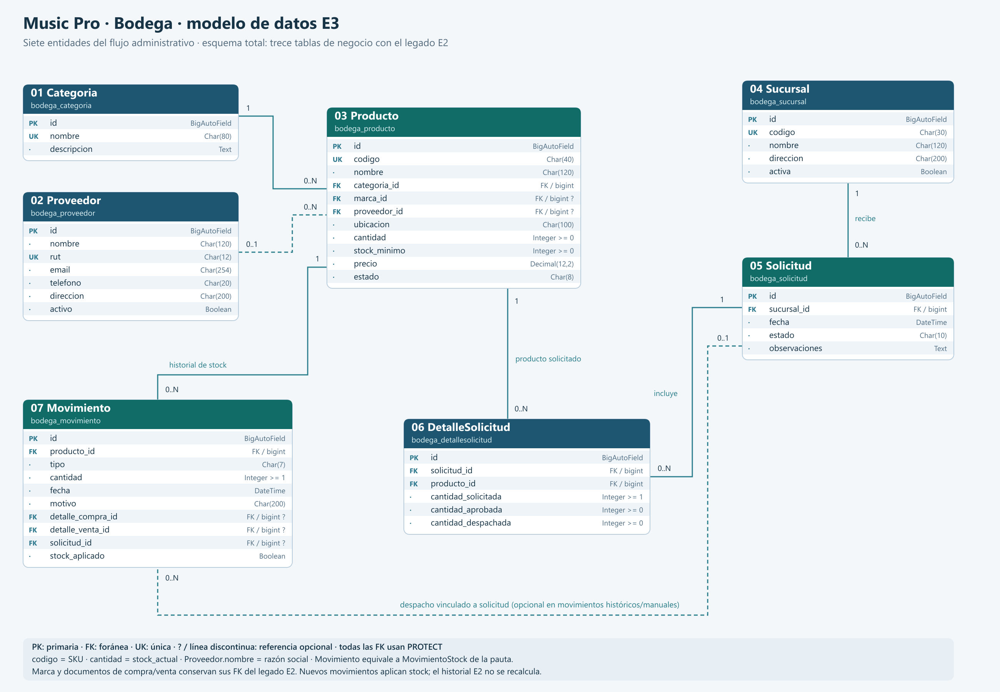
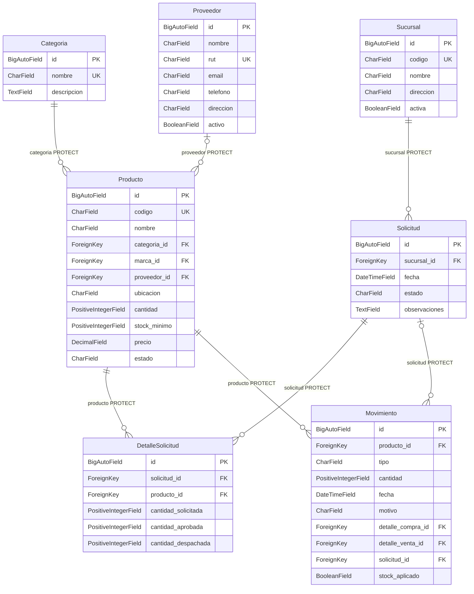

# Modelo de Bodega para la evaluación 3

Este documento corresponde al sistema propio de E3. El proyecto conserva las diez tablas de negocio de E2 y añade **Sucursal, Solicitud y DetalleSolicitud**: el esquema completo contiene **trece tablas de negocio**. Aquí se muestran las siete entidades principales del flujo Bodega. El diagrama anterior de E2 se retiró del repositorio; este documento describe el modelo actual y sus relaciones.

[Abrir SVG ampliable](diagrama_bodega_e3.svg).

## Correspondencias con la pauta

| Término de la pauta | Campo o modelo del proyecto | Motivo |
| --- | --- | --- |
| SKU | `Producto.codigo` | Conserva los códigos de E2 y su unicidad. |
| Stock actual | `Producto.cantidad` | Conserva las existencias existentes. |
| Razón social | `Proveedor.nombre` | Nombre de identificación del proveedor. |
| MovimientoStock | `Movimiento` | Modelo existente ampliado con solicitud y aplicación al stock. |
| Cantidad solicitada, aprobada y despachada | Campos homónimos de `DetalleSolicitud` | Permiten aprobación parcial y trazabilidad del despacho. |

La referencia de proveedor admite NULL en la base para conservar productos antiguos; el formulario propio exige seleccionar un proveedor para nuevos productos. Las referencias de marca y documentos de compra/venta siguen disponibles para el legado E2.

## Entidades, atributos y relaciones

### Categoria: `bodega_categoria`

| Campo | Tipo Django | Clave | Referencia o valores |
| --- | --- | --- | --- |
| `id` | `BigAutoField` | PK | opcional en formulario |
| `nombre` | `CharField(80)` | UK | obligatorio |
| `descripcion` | `TextField` | · | opcional en formulario |

### Proveedor: `bodega_proveedor`

| Campo | Tipo Django | Clave | Referencia o valores |
| --- | --- | --- | --- |
| `id` | `BigAutoField` | PK | opcional en formulario |
| `nombre` | `CharField(120)` | · | obligatorio |
| `rut` | `CharField(12)` | UK | obligatorio |
| `email` | `CharField(254)` | · | opcional en formulario |
| `telefono` | `CharField(20)` | · | opcional en formulario |
| `direccion` | `CharField(200)` | · | opcional en formulario |
| `activo` | `BooleanField` | · | obligatorio |

### Producto: `bodega_producto`

| Campo | Tipo Django | Clave | Referencia o valores |
| --- | --- | --- | --- |
| `id` | `BigAutoField` | PK | opcional en formulario |
| `codigo` | `CharField(40)` | UK | obligatorio |
| `nombre` | `CharField(120)` | · | obligatorio |
| `categoria_id` | `ForeignKey` | FK | `Categoria.id`, PROTECT |
| `marca_id` | `ForeignKey` | FK | `Marca.id`, PROTECT; NULL permitido por compatibilidad |
| `proveedor_id` | `ForeignKey` | FK | `Proveedor.id`, PROTECT; NULL permitido por compatibilidad |
| `ubicacion` | `CharField(100)` | · | obligatorio |
| `cantidad` | `PositiveIntegerField` | · | ≥ 0 |
| `stock_minimo` | `PositiveIntegerField` | · | ≥ 0 |
| `precio` | `DecimalField(12, 2)` | · | ≥ 0 |
| `estado` | `CharField(8)` | · | ACTIVO, INACTIVO |

### Sucursal: `bodega_sucursal`

| Campo | Tipo Django | Clave | Referencia o valores |
| --- | --- | --- | --- |
| `id` | `BigAutoField` | PK | opcional en formulario |
| `codigo` | `CharField(30)` | UK | obligatorio |
| `nombre` | `CharField(120)` | · | obligatorio |
| `direccion` | `CharField(200)` | · | opcional en formulario |
| `activa` | `BooleanField` | · | obligatorio |

### Solicitud: `bodega_solicitud`

| Campo | Tipo Django | Clave | Referencia o valores |
| --- | --- | --- | --- |
| `id` | `BigAutoField` | PK | opcional en formulario |
| `sucursal_id` | `ForeignKey` | FK | `Sucursal.id`, PROTECT |
| `fecha` | `DateTimeField` | · | obligatorio |
| `estado` | `CharField(10)` | · | PENDIENTE, APROBADA, RECHAZADA, DESPACHADA |
| `observaciones` | `TextField` | · | opcional en formulario |

### DetalleSolicitud: `bodega_detallesolicitud`

| Campo | Tipo Django | Clave | Referencia o valores |
| --- | --- | --- | --- |
| `id` | `BigAutoField` | PK | opcional en formulario |
| `solicitud_id` | `ForeignKey` | FK | `Solicitud.id`, PROTECT |
| `producto_id` | `ForeignKey` | FK | `Producto.id`, PROTECT |
| `cantidad_solicitada` | `PositiveIntegerField` | · | entero ≥ 1 |
| `cantidad_aprobada` | `PositiveIntegerField` | · | ≥ 0 |
| `cantidad_despachada` | `PositiveIntegerField` | · | ≥ 0 |

### Movimiento: `bodega_movimiento`

| Campo | Tipo Django | Clave | Referencia o valores |
| --- | --- | --- | --- |
| `id` | `BigAutoField` | PK | opcional en formulario |
| `producto_id` | `ForeignKey` | FK | `Producto.id`, PROTECT |
| `tipo` | `CharField(7)` | · | INGRESO, SALIDA |
| `cantidad` | `PositiveIntegerField` | · | ≥ 0 |
| `fecha` | `DateTimeField` | · | obligatorio |
| `motivo` | `CharField(200)` | · | obligatorio |
| `detalle_compra_id` | `ForeignKey` | FK | `DetalleCompra.id`, PROTECT; NULL permitido por compatibilidad |
| `detalle_venta_id` | `ForeignKey` | FK | `DetalleVenta.id`, PROTECT; NULL permitido por compatibilidad |
| `solicitud_id` | `ForeignKey` | FK | `Solicitud.id`, PROTECT; NULL permitido por compatibilidad |
| `stock_aplicado` | `BooleanField` | · | False para historial E2; True para movimientos de servicios E3 |

## Integridad y flujo de stock

- `DetalleSolicitud` no repite un producto dentro de la misma solicitud. La base exige `0 ≤ cantidad_despachada ≤ cantidad_aprobada ≤ cantidad_solicitada`, con cantidad solicitada ≥ 1.
- Una solicitud nace PENDIENTE. Solo mientras está pendiente admite edición y eliminación. La aprobación puede reducir cantidades; el rechazo no cambia existencias.
- APROBADA permite despachar todas sus cantidades aprobadas en una transacción. Cada producto registra una salida, se descuenta con `F()` y se exige stock suficiente. Ante un fallo, se revierten todas las salidas y cambios del despacho.
- DESPACHADA y RECHAZADA son estados terminales. Repetir el despacho se rechaza y no vuelve a descontar existencias.
- Los nuevos ingresos/salidas de la interfaz utilizan `registrar_movimiento`: bloquean el producto, validan cantidades y guardan el historial junto con el cambio de stock. Los movimientos aplicados no admiten modificación ni eliminación por los flujos de gestión.
- Los movimientos históricos de E2 tienen `stock_aplicado=False`: no se aplican retroactivamente y no cambian las existencias conservadas. El stock inicial de los ejemplos nuevos sí se registra como ingreso E3.
- Los permisos de consulta, creación, modificación y eliminación se comprueban en las vistas. Aprobar/rechazar requiere `bodega.aprobar_solicitud` y despachar requiere `bodega.despachar_solicitud`; estas transiciones solo utilizan POST con CSRF.

## Muestra ficticia y demostración

Después de migrar y configurar los roles, `python manage.py cargar_demo_bodega` añade una muestra pequeña con prefijo **DEMO-E3**: dos categorías, dos proveedores, cuatro productos, tres sucursales y solicitudes en los cuatro estados. Los valores, nombres, identificadores de proveedor y direcciones son ficticios; los precios son ejemplos de catálogo y no cotizaciones.

Los productos se crean sin stock y reciben ingresos registrados por el servicio. Un despacho de muestra descuenta tres guitarras y cinco cables; los stocks finales de `DEMO-E3-P01` a `P04` son **17, 12, 25 y 8**. La carga completa es atómica. Si el centinela `DEMO-E3-P01` existe, una nueva ejecución no añade ni reescribe datos. Si detecta el prefijo sin ese centinela, informa la colisión y no modifica registros.

La muestra usa la fecha real de ejecución. No inventa fechas del mes anterior ni altera movimientos aplicados para rellenar reportes: el reporte del último mes puede mostrar cero resultados si todavía no hay actividad en ese período.

## Migraciones

`0006_producto_precio_estado` añade precio y estado conservando productos existentes. `0007_bodega_solicitudes_stock` incorpora las tres entidades y las extensiones de Bodega con valores compatibles con E2. La presencia del archivo de migración no acredita su aplicación: comprobar con `showmigrations bodega` y ejecutar `migrate` en la base elegida.
